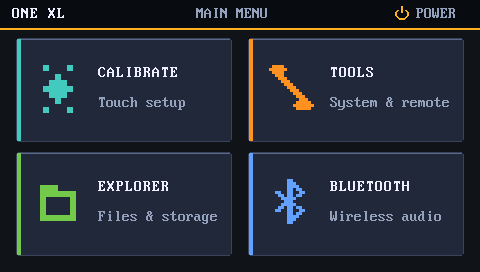

# Linux 6.1 on the TomTom ONE XL

A working Linux 6.1.182 port for the **TomTom ONE XL**, with a native 480×272 touchscreen shell, audio, Bluetooth A2DP sink support, USB networking/SSH, terminal, file explorer and touch calibration.



> **Status:** the Linux 6.1.182 #176 kernel, audio/Bluetooth stack and V3 shell are hardware-tested on a real TomTom ONE XL (Samsung S3C2412 / ARM9). The public `ttsystem` release uses that accepted base with sanitized SSH-key provisioning; it is build/TTBL-validated but has not yet been separately reboot-tested on hardware.

## What works

- Linux **6.1.182** on Samsung S3C2412 / ARM9
- 480×272 RGB565 framebuffer
- resistive touchscreen + persistent calibration
- SD/FAT storage
- native V3 launcher/shell
- ALSA audio through S3C2412 I2S + WM8711
- CSR BlueCore Bluetooth over BCSP UART at 460800 baud
- BlueZ 5.86 + BlueALSA 4.3.1 A2DP sink
- phone-controlled Bluetooth volume
- USB networking at `192.168.7.2`
- Dropbear SSH
- built-in terminal
- file explorer + text viewer
- hardware-safe reboot / power-off paths

The current shell keeps a simple four-tile layout inspired by the clarity of the original TomTom UI without trying to clone it:

- **CALIBRATE** — touchscreen setup
- **TOOLS** — terminal and USB/SSH
- **EXPLORER** — device and SD-card files
- **BLUETOOTH** — wireless audio pairing/status

## Quick install

1. Open the latest GitHub **Release**.
2. Download the asset named **`ttsystem`**.
3. Connect the TomTom in mass-storage mode.
4. Back up the existing `ttsystem` from the device root.
5. Copy the downloaded file to the device root as:

   ```text
   /ttsystem
   ```

6. Safely eject the TomTom and boot it.

No installer or flashing utility is required.

## Public-release SSH setup

The public image intentionally ships with **no shared SSH host private keys and no personal login key**.

For USB SSH:

1. Put your SSH public key on the TomTom SD/FAT volume as:

   ```text
   /authorized_keys
   ```

2. Open **TOOLS → USB + SSH**.
3. Start SSH.
4. Connect from the host computer:

   ```sh
   ssh root@192.168.7.2
   ```

On first use the TomTom generates its own Dropbear host key and stores it under `/sdcard/.dropbear/`, so its SSH fingerprint remains stable across reboots. Password authentication is disabled.

## Repository layout

```text
configs/                     Reference and production kernel/Buildroot configs
docs/                        Hardware notes, audits, packaging and UI documentation
kernel/patches/               Linux 6.1.182 TomTom preservation/port patch
reference/                    Provenance, image identity and source manifests
third_party/patches/          BlueZ/BlueALSA platform patches
userspace/bluetooth/          Bluetooth startup, pairing and audio configuration
userspace/diagnostics/        Hardware/audio diagnostic utilities
userspace/launcher/           Native 480×272 framebuffer shell
userspace/pid1/               Tiny custom PID1/supervisor
tools/                        Rebuild/materialization helpers
```

Generated binaries are deliberately kept out of Git. The installable `ttsystem` lives under **Releases**.

## Kernel / image identity

The public V3 release is based on:

```text
Linux:        6.1.182
Build:        #176 Wed Oct 14 12:14:40 BST 2026
Architecture: ARM / Samsung S3C2412
Display:      480×272
```

The public-safe release differs from the private hardware-preservation image only in SSH identity provisioning: it removes embedded host/login keys and generates a per-device host identity on first use. Kernel platform code, audio path and V3 launcher are unchanged.

Current public-release SHA-256 values:

```text
zImage   2061081239680f17eb476cf8e299e5e5bbe5806e9c5ea55cdab7998f41ada4db
ttsystem 0033810e10b5a79955b6398c60028413706ed0068893a9b2cfcbc2430ce1cb21
launcher 50ceebbf92dfd8c9444a8f0aae6dce39ea2ead543c451ae5ade75af2b59f7cac
```

Release assets also include a checksum file.

## Building

This repository is the compact development/consolidation tree rather than a vendored 1.7 GB Linux source dump.

Start from pristine **Linux 6.1.182**, apply:

```text
kernel/patches/0000-current-k6-preservation.patch
```

and use the reference config under `configs/`. The custom PID1, launcher and platform userspace sources are in `userspace/`.

The exact build identity used for the accepted image is documented in `docs/UI-V3-FINAL-20261014.md` and `docs/BT-SHELL-PACKAGING-20261014.md`.

## Bluetooth notes

The final hardware configuration uses CSR BlueCore over BCSP and an A2DP sink built around BlueZ/BlueALSA. The project history includes the pacing/queue diagnostics that were used to eliminate the earlier multi-second latency/cadence problem.

See:

- `docs/BT-A2DP-PACING-DIAGNOSTIC-20260916.md`
- `docs/PROJECT-AUDIT-20260916.md`
- `docs/UI-V3-FINAL-20261014.md`

## Hardware target

This work targets the **TomTom ONE XL** platform used in this project. Other TomTom models may differ in SoC, display, audio codec, boot image format or GPIO wiring; do not assume drop-in compatibility.

## Project scope

This is an independent Linux port / hardware-research project. It is not an official TomTom product or firmware release. TomTom trademarks belong to their respective owner.
